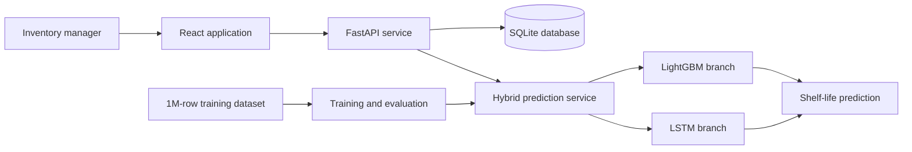
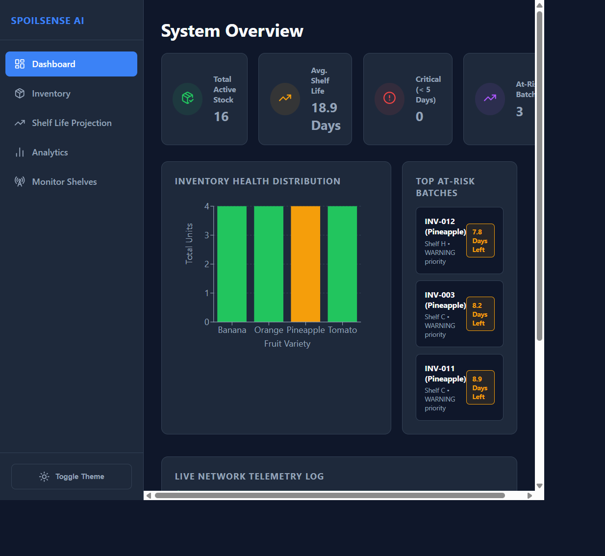
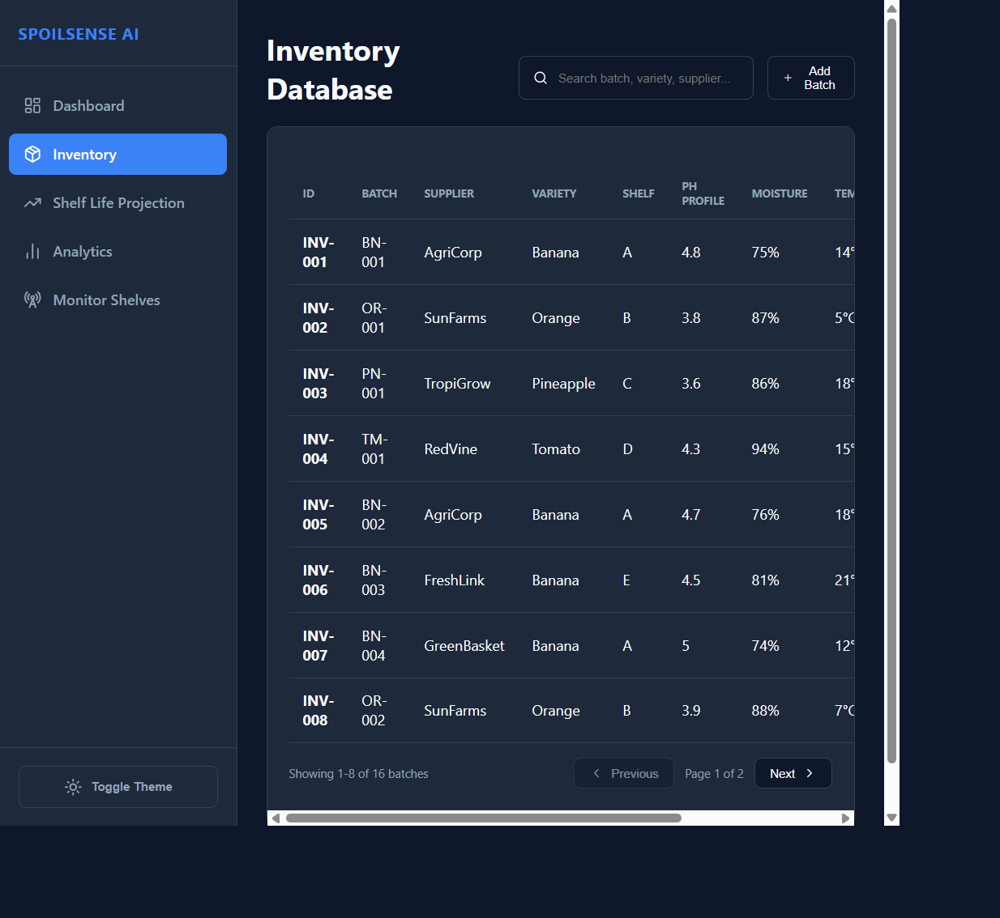
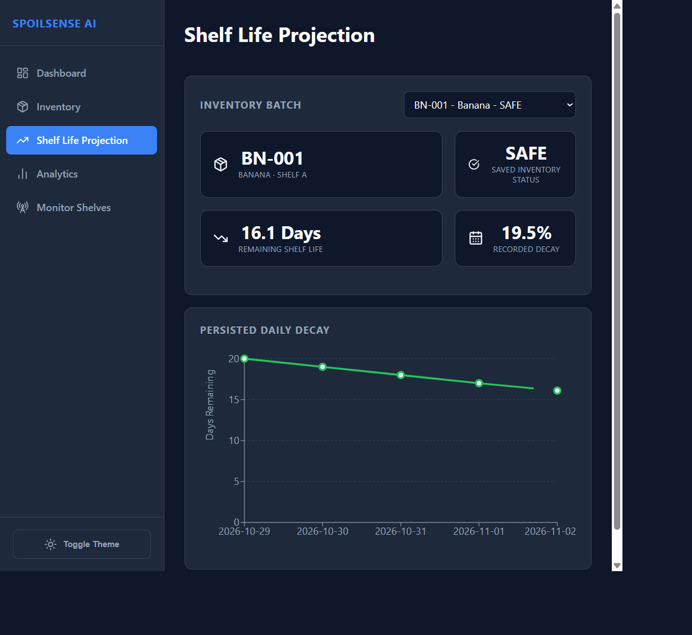
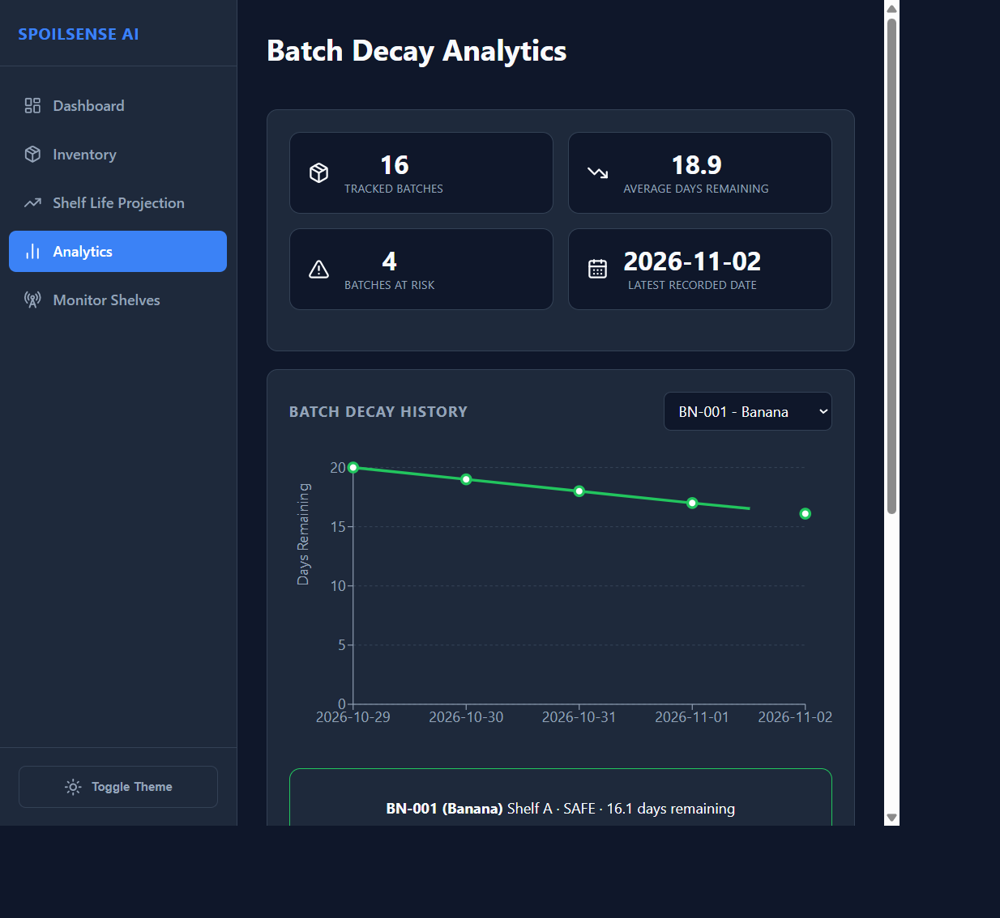
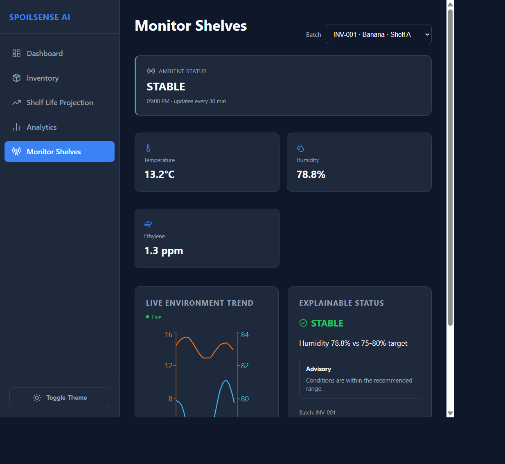

# SpoilSense AI

SpoilSense AI helps inventory managers protect perishable stock. It stores batches in SQLite, predicts remaining shelf life with a LightGBM and LSTM hybrid model, and shows clear actions for stock that needs attention.

## What the system does

- Stores inventory, predictions, statuses, and decay history in SQLite.
- Uses the real `inventory_dataset_1M.csv` file for model training and evaluation.
- Runs the hybrid model before a new batch is saved.
- Keeps saved predictions and statuses stable for review.
- Shows inventory health, shelf-life decay, and live shelf conditions.
- Simulates shelf sensor readings at one-minute intervals. Each reading represents a 30-minute environmental interval.
- Explains an ambient status with the environmental factor that triggered it and a short advisory.

Only these dataset varieties are supported:

- Banana
- Orange
- Pineapple
- Tomato

## High-level architecture



The browser reads inventory and decay records through the API. The database is the source of truth. The model artifacts are loaded by the backend and do not retrain when the application starts.

## Application views

### Dashboard



The dashboard gives a quick operating view. It shows total stock, average remaining shelf life, critical batches, batches at risk, health by variety, and the latest database-backed prediction log.

### Inventory



The inventory view lists saved batches with their variety, shelf, readings, status, and predicted days remaining. Managers can search, page through batches, and add a new batch. A new batch is analyzed before it is saved.

### Shelf Life Projection



The projection view selects a saved batch and displays its stored shelf-life history. The summary shows the saved status, current remaining days, and recorded decay.

### Batch Decay Analytics



The analytics view summarizes tracked batches, average remaining days, risk count, and the latest recorded date. It includes a selected-batch history and one decay trend for each supported variety.

### Monitor Shelves



Monitor Shelves selects batches directly from the database. It displays generated temperature, humidity, and ethylene readings, a live trend chart, and an explainable ambient status. Stable, watch, and alert statuses include a reason and a practical advisory.

## Local setup

### Windows PowerShell

```powershell
python -m venv .venv
.\.venv\Scripts\Activate.ps1
pip install -r backend\requirements.txt
```

Start the backend in one terminal:

```powershell
python -m uvicorn backend.main:app --host 0.0.0.0 --port 8000
```

Start the frontend in a second terminal:

```powershell
cd frontend
npm ci
npm run dev
```

If PowerShell blocks activation, run:

```powershell
Set-ExecutionPolicy -Scope Process -ExecutionPolicy Bypass
```

### macOS or Linux

```bash
python3 -m venv .venv
source .venv/bin/activate
pip install -r backend/requirements.txt
python -m uvicorn backend.main:app --host 0.0.0.0 --port 8000
```

In a second terminal:

```bash
cd frontend
npm ci
npm run dev
```

Open the frontend URL printed by Vite. The backend uses port 8000 by default.

### Docker

Docker Compose starts the backend and frontend. SQLite data is kept in a named volume.

```bash
docker compose up --build
```

Open `http://localhost:5173`. Stop the services with:

```bash
docker compose down
```

## Configuration

No environment file is required for the standard local setup. The backend uses `backend/inventory.sqlite3` and the frontend uses the local backend address by default. These defaults are kept in the application configuration so a new developer can clone the project and run it without creating secret or configuration files.

## Database setup

Another developer does not need to create tables manually. The backend creates `backend/inventory.sqlite3`, applies the schema migrations, and inserts the saved inventory rows when the first inventory request is made.

The default database path is:

```text
backend/inventory.sqlite3
```

The complete table definition is available in [`backend/data/schema.sql`](backend/data/schema.sql). It contains:

- `inventory`: saved batches, readings, statuses, and shelf-life predictions.
- `inventory_decay`: daily remaining shelf-life history for each batch.
- `schema_migrations`: applied migration versions used to keep setup repeatable.

### Automatic setup

From the repository root:

```powershell
python -m venv .venv
.\.venv\Scripts\Activate.ps1
pip install -r backend\requirements.txt
python -m uvicorn backend.main:app --host 0.0.0.0 --port 8000
```

Then open the frontend or request the inventory data:

```powershell
Invoke-WebRequest http://localhost:8000/api/inventory
```

For macOS or Linux, the equivalent request is:

```bash
curl http://localhost:8000/api/inventory
```

This creates the database, applies all migrations, and loads sixteen persisted batches with decay history. Running the request again is safe and does not duplicate rows.

### Optional manual schema setup

If a developer wants to create the empty database before starting the backend and has the SQLite command-line tool installed:

```powershell
sqlite3 backend\inventory.sqlite3 ".read backend\data\schema.sql"
```

On macOS or Linux:

```bash
sqlite3 backend/inventory.sqlite3 ".read backend/data/schema.sql"
```

The backend still runs its migrations after this command. The seed rows are intentionally inserted by the migration process, not by the standalone schema file. The migration is safe to run again and does not duplicate records.

## Training and evaluation

The training pipeline reads the complete dataset, cleans the required columns, and creates a stratified train, validation, and test split. LightGBM uses pH, moisture, temperature summaries, and variety features. The LSTM uses the five-day temperature sequence. The hybrid result combines the LightGBM prediction with the LSTM residual correction.

Evaluation runs on held-out data and reports mean absolute error, root mean squared error, and R-squared. The trained LightGBM model, LSTM weights, scalers, metadata, and metrics are created in `backend/models`. These generated files should not be uploaded with the source code.

To retrain or evaluate from the repository root:

```powershell
python -m backend.training.train_hybrid
python -m backend.evaluation.evaluate_hybrid
```

On macOS or Linux, use the same commands after activating the virtual environment.

